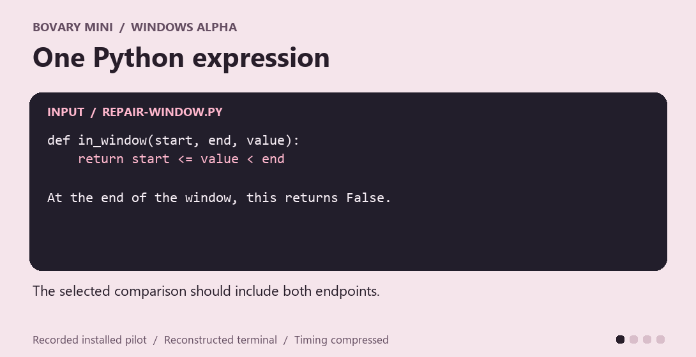

<p align="center">
  
</p>

# How much AI can you run on the laptop you already own?

**Bovary runs Gemma 4 26B locally on Windows.** Use it to turn a note into a checklist or ask for a small code edit. After setup, it works offline and keeps your prompts and files on your laptop. The Windows package runs on the CPU. With the optional CUDA build, a laptop with a 6 GB RTX 3060 finished a verified code edit in 19.25 seconds.

[Install the packaged CPU version](#install-the-windows-alpha-from-release-files) · [Build the NVIDIA CUDA version](docs/reproducibility.md#build-and-try-the-cuda-worker)

## Turn a note into a checklist

We gave Mini this school fair planning note.

> Sam will book the hall by Tuesday. Lee offered to print the posters by Friday. We still need someone to bring the folding tables.

Here’s the recorded answer from one fresh Windows CPU run. It took **22.66 seconds** wall-clock time, with no answer-cache hit.

> **School Fair Planning Checklist**
>
> * [ ] Book the hall (Sam) – **Deadline: Tuesday**
> * [ ] Print the posters (Lee) – **Deadline: Friday**
> * [ ] Bring the folding tables (Open) – **Deadline: N/A**

## Try it on your laptop

After [CPU setup](#install-the-windows-alpha-from-release-files), run the same prompt in the configured PowerShell session. The JSON includes the status, answer text, and any reported error.

```powershell
$prompt = 'Turn this school fair planning note into a short checklist. Keep each owner and deadline. Mark the undecided item as open. Do not invent details. Note: Sam will book the hall by Tuesday. Lee offered to print the posters by Friday. We still need someone to bring the folding tables.'
.\.venv\Scripts\bovary.exe mini --tokens 128 --json --prompt $prompt | ConvertFrom-Json | Format-List status, text, elapsed_s, error, message
```

On a 2-vCPU Windows Server test, the arithmetic smoke test took about 89 seconds and the checklist stopped after about 180 seconds. Mini allows three minutes per request. If the arithmetic test takes a minute or more, you can go straight to the longer command below using the same prompt. It uses two threads and allows up to 20 minutes for the request. The JSON appears when the command finishes.

```powershell
.\.venv\Scripts\bovary.exe --mode local --offline --preset cpu-only --threads 2 --context 2048 --tokens 128 --deadline-s 1200 --json --prompt $prompt
```

Check for a complete result. Sam should still have the hall by Tuesday, Lee should have the posters by Friday, and the folding tables should remain open without an invented owner or deadline. Wording can vary.

Share your hardware, which command you used, the status, and which details the answer kept. Use `elapsed_s` from Mini or `timing.end_to_end_s` from the longer command. If a step failed, include that step and a redacted error. [Report your laptop results](https://github.com/ajuelosemmanuel/bovary-windows/issues/new?title=%5BWindows%20review%5D%20School%20fair%20checklist&body=Laptop%20model%3A%0ACPU%20or%20GPU%3A%0ARAM%3A%0ACommand%20used%20%28Mini%20or%20longer%20CPU%20command%29%3A%0AStatus%3A%0AElapsed%20seconds%3A%0A%0AChecklist%20results%0A-%20Sam%20books%20the%20hall%20by%20Tuesday%3A%0A-%20Lee%20prints%20the%20posters%20by%20Friday%3A%0A-%20The%20folding%20tables%20remain%20open%20without%20a%20new%20owner%20or%20deadline%3A%0A%0AFirst%20setup%20blocker%2C%20if%20any%20%28step%20and%20redacted%20error%29%3A%0A)

## Measured speed and memory on a 6 GB GPU

On an RTX 3060 Laptop GPU with 6 GB of VRAM, Mini finished a Python edit in a median **19.25 seconds** at the default host-cache setting. Median peak system RAM for the native inference worker was **635 MiB**. The CUDA worker keeps frequently used expert weights on the GPU and streams others from SSD. An optional host cache uses additional system RAM to cut SSD reads.

The table shows medians from three pairs of fresh 0.2.0a15 runs on that laptop using the same 107-token prompt for a full-function edit.

| Extra host cache | First visible token | Time to finish | Peak native worker working set | Peak GPU memory across all apps |
|---|---:|---:|---:|---:|
| 0 MiB (default) | 6.10 s | 19.25 s | 635 MiB | 5,040 MiB |
| 4,096 MiB | 6.40 s | 16.79 s | 4,731 MiB | 5,040 MiB |

Setting `--host-cache-mib 4096` took **12.7% less time** for this edit, and all six runs returned the same 69 output tokens. In one pair, a shorter clamp task took 7.41 seconds at 0 MiB and 7.87 seconds at 4096 MiB. Each trial started a fresh worker on performance cores. Windows file cache state was uncontrolled. [Timings and settings](docs/usage.md#mini-mode)

## Choose your Windows setup

- **Packaged CPU.** Install the Python wheel and CPU runtime ZIP from the release files below. The CPU worker is the default and runs without an NVIDIA GPU.
- **Source-built NVIDIA CUDA.** Build the CUDA worker, make its runtime dependencies available, and select `--preset gpu-prefill-2g`. With the wheel, set `BOVARY_CUDA_EXE` to the built `bovary-infer.exe`. [CUDA build instructions](docs/reproducibility.md#build-and-try-the-cuda-worker)

Both paths use the same pinned **14.6 GB Gemma checkpoint**. [Verify or obtain the checkpoint](docs/configuration.md#verify-or-obtain-the-pinned-checkpoint)

## Install the Windows alpha from release files

Use Windows x64, an AVX2/FMA-capable CPU, and 64-bit Python 3.11 or newer with Tcl/Tk and the `python` command available in PowerShell. The CPU worker needs the Microsoft x64 C++/OpenMP runtime. [Microsoft Visual C++ Redistributable downloads](https://learn.microsoft.com/en-us/cpp/windows/latest-supported-vc-redist/)

Download the wheel, CPU runtime ZIP, and `SHA256SUMS.txt` into one fresh folder, then open PowerShell in that folder. Run each block in this same session and stop if a block reports an error. [0.2.0a16 Windows alpha](https://github.com/ajuelosemmanuel/bovary-windows/releases/tag/v0.2.0a16)

```powershell
$zip = 'bovary-0.2.0a16-cpu-review.zip'
$wheel = 'bovary-0.2.0a16-py3-none-any.whl'
$checksums = @(Get-Content -LiteralPath .\SHA256SUMS.txt -ErrorAction Stop)
foreach ($file in @($zip, $wheel)) {
    $pattern = '^([a-f0-9]{64})\s+' + [regex]::Escape($file) + '$'
    $entry = @($checksums -match $pattern)
    if ($entry.Count -ne 1) { throw "Expected one checksum for $file." }
    $expected = ($entry[0] -split '\s+')[0]
    $actual = (Get-FileHash -LiteralPath $file -Algorithm SHA256 -ErrorAction Stop).Hash
    if ($actual -ne $expected) { throw "SHA256 mismatch for $file." }
}
Expand-Archive -LiteralPath $zip -DestinationPath .\runtime -ErrorAction Stop
python -m venv .venv
if ($LASTEXITCODE -ne 0) { throw "Virtual environment creation failed." }
.\.venv\Scripts\python.exe -m pip install --no-index --no-deps ".\$wheel"
if ($LASTEXITCODE -ne 0) { throw "Wheel installation failed." }
$env:BOVARY_HOME = (Resolve-Path -LiteralPath .\runtime -ErrorAction Stop).Path
$protocol = & .\runtime\work\build\bovary-cpu\bovary-infer.exe --require-cpu-only --protocol-version
if ($LASTEXITCODE -ne 0 -or $protocol -ne 'bovary-worker 2') { throw "CPU worker startup check failed. Run bovary doctor as shown below." }
```

Mini uses one pinned **14.6 GB** Gemma checkpoint. Choose one of the next two blocks. [Checkpoint identity and model terms](docs/configuration.md#verify-or-obtain-the-pinned-checkpoint)

**If you already have the checkpoint**, replace the example path with the path to your file. The verifier reads the whole file and creates a proof. If a conflicting proof already exists, choose a new filename for `$proof`.

```powershell
$model = 'D:\Models\gemma-4-26B-A4B-it-Q4_0.gguf'
$proof = Join-Path $env:BOVARY_HOME 'model-provenance.json'
.\.venv\Scripts\python.exe .\runtime\tools\verify_model.py --model $model --manifest $proof
if ($LASTEXITCODE -ne 0) { throw "Checkpoint verification failed." }
$env:BOVARY_MODEL = $model
$env:BOVARY_MODEL_MANIFEST = $proof
```

**If you need the checkpoint**, review the model terms above first. The downloader needs space for the remaining download plus 3 GiB. It resumes an interrupted transfer and verifies the file before creating its proof.

```powershell
$modelDirectory = Join-Path $env:BOVARY_HOME 'work\models'
.\.venv\Scripts\python.exe .\runtime\tools\download_model.py --directory $modelDirectory
if ($LASTEXITCODE -ne 0) { throw "Checkpoint download or verification failed." }
$env:BOVARY_MODEL = Join-Path $modelDirectory 'gemma-4-26B-A4B-it-Q4_0.gguf'
$env:BOVARY_MODEL_MANIFEST = Join-Path $modelDirectory 'model-provenance.json'
```

**Run the offline smoke test** after your model setup succeeds.

```powershell
.\.venv\Scripts\bovary.exe mini --prompt 'What is 17 plus 28? Answer with just the number.'
if ($LASTEXITCODE -ne 0) { throw "Mini smoke test failed." }
```

The 0.2.0a16 smoke test returned `45` from a fresh offline install. If setup needs attention, run `.\.venv\Scripts\bovary.exe doctor` in the same shell. Before model setup, a missing manifest is expected. The packaged verifier and downloader are under `.\runtime\tools\`, even if the 0.2.0a16 diagnostic points to a source checkout.

## Try a code edit

Suppose a loop skips the last item in a list. Save this as `example.py`:

```python
def print_items(items):
    for i in range(len(items) - 1):
        print(items[i])
```

Ask Mini to replace just the loop bound:

```powershell
.\.venv\Scripts\bovary.exe mini --context-file .\example.py --replace-expr 'len(items) - 1' --prompt 'Include the final item.'
```

Gemma generates the replacement expression. Mini checks that the surrounding Python syntax tree is preserved and prints the revised function for you to review. Your file stays untouched.



In this replay of a recorded 0.2.0a14 run on an RTX 3060 Laptop GPU, Mini changed `start <= value < end` to `start <= value <= end` in **9.30 seconds** with a fresh CUDA worker and no answer-cache hit. A separate check passed all **405 input combinations**. [Replay details](docs/use-cases.md#repair-demo)

Mini repaired both selected expressions in our eight-task pilot. It also missed one of two seeded bugs during review. [Coding tasks, timings, and checks](docs/use-cases.md)

## Choose how to run

| If you want to… | Start here |
|---|---|
| Run several independent tasks with one model load | Repeat `--prompt` up to eight times in one [Mini batch](docs/usage.md#mini-mode). |
| Keep the model warm between prompts | Start an [interactive session](docs/usage.md#interactive-mode). Use `/unload` to release its memory. |
| Use a desktop window | Launch `.\.venv\Scripts\bovary-settings.exe` from the configured shell. [Desktop setup](docs/configuration.md#doctor-and-gui-model-setup) |
| Stream answers from Python | Use the [Python API](docs/usage.md#python-api) and its cancellation and unload controls. |
| Experiment with Inkling 2 Mini | The [developer preview](previews/inkling/README.md) has a separate CUDA worker and packed SSD layout. It can propose tokens from code in your prompt and verify them during generation. |

## Project

[Architecture](docs/architecture.md) · [Configuration](docs/configuration.md) · [Release notes](RELEASE_NOTES.md) · [Contributing](CONTRIBUTING.md) · [Security](SECURITY.md)

Bovary’s software uses the [MIT license](LICENSE). Model weights and runtime dependencies have their own terms. [Third-party notices](THIRD_PARTY_NOTICES.md)
