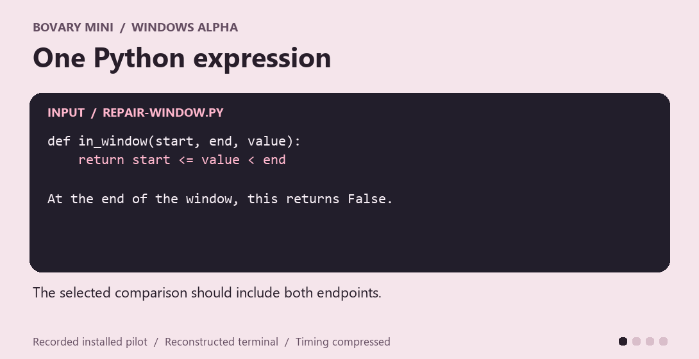

# Small coding tasks with Bovary Mini

Mini can propose a counterexample for a small Python function, draft a regression assertion, or change a single expression in a supplied file. Give it the function's behavior and input bounds.

## Run from an installed wheel

The examples assume `bovary` is on `PATH` and the local GGUF and verification manifest are configured. CPU is the default. For the CUDA profile used in the pilot, make the built worker and its runtime dependencies available and add `--preset gpu-prefill-2g`. See [setup and Mini mode](usage.md#mini-mode).

### Check a function against a contract

```powershell
$prompt = @'
Review only for behavior against the contract. Reply exactly OK if correct.
Otherwise reply BUG followed by one call and its expected result.
A full or partial page counts as one. Count is nonnegative and size is positive.
def pages(count, size):
    return count // size
'@
bovary mini --tokens 48 --json --prompt $prompt
```

Run any proposed counterexample against the original and independently confirm the expected result. An `OK` answer still needs review and tests.

### Draft a regression assertion

```powershell
$prompt = @'
Suggest one executable Python assert for the wrap-around boundary.
Return the next index in a circular list. Size is positive and 0 <= index < size.
def next_index(index, size):
    return (index + 1) % size
'@
bovary mini --tokens 48 --json --prompt $prompt
```

Check that the assertion passes on the correct code and fails on the specific broken behavior it should catch.

### Repair a selected Python expression

Given `window.py` containing

```python
def in_window(start, end, value):
    return start <= value < end
```

ask Mini to replace the comparison.

```powershell
bovary mini --tokens 48 --json --context-file .\window.py --replace-expr 'start <= value < end' --prompt 'Fix the selected comparison so both endpoints are included. Inputs are integer values with start <= end.'
```

Mini validates the syntax tree and returns the revised source with the original file intact. Exercise both endpoints and outside values before applying the edit.

### Repair demo



The replay reconstructs a recorded run of Bovary 0.2.0a14 on an RTX 3060 Laptop GPU with the optional CUDA worker. The command took 9.30 seconds with a fresh worker and no answer-cache hit. The replay shortens paths, displays the decoded JSON response text, and compresses the elapsed time. A separate check passed all 405 interval and value combinations.

## Synthetic pilot

On November 22, 2026, the installed Bovary 0.2.0a14 wheel ran eight synthetic Python tasks on the Windows laptop's RTX 3060 Laptop GPU with 6 GiB of VRAM. It used the regular CUDA worker and the `gemma-4-26B-A4B-it-Q4_0.gguf` checkpoint at revision `1ca99aae748b4b01f609fa51eb23682ee5f00b85`. Each request had a 48-token cap. All eight invoked the model once, without answer-cache hits. The reviews and assertions shared a worker. Each expression repair started its own worker.

| Task | Passed | CLI wall time |
| --- | ---: | ---: |
| Check two known defects and two clean functions | 3/4 | 43.27 s for the six-task batch |
| Draft two runnable regression assertions | 1/2 | Included in the batch |
| Repair a selected expression in each of two files | 2/2 | 9.30 s and 12.38 s |

- **Review.** Mini returned a valid counterexample for integer pagination and correctly returned `OK` for the inclusive-range and ordered-deduplication controls. It started to analyze the reversed subtraction in `deltas([1, 2, 3])` but gave an inconsistent example and hit the token cap. The intended result was `[1, 1]` and the function returned `[-1, -1]`. The batch exited with code 2 and preserved the partial response.
- **Assertions.** The equal-pair assertion passed the reference function and failed an implementation that counted only non-overlapping pairs. The wrap-around assertion used an undefined `size` variable and could not run as submitted.
- **Repairs.** Mini corrected an inclusive endpoint and a rounded-up batch count. Both revised functions passed independent checks over 405 and 410 input combinations, respectively. The supplied files stayed intact.

Start with expression repairs when you can name the faulty expression, state the intended behavior, and run deterministic tests. For review and test drafting, inspect the counterexample or assertion before using it. This single run used tiny synthetic functions and uncontrolled Windows file-cache state. There was no human timing, energy measurement, or comparison with writing the fix or test directly.
